# Kế hoạch khôi phục luồng local → GitHub → Plesk

Ngày:26/10/2026. **R1–R5 đã đạt theo từng phê duyệt; chủ dự án đã duyệt R6 chốt hồ sơ.** [R6](acceptance/R6-closeout.vi.md), [runbook hiện hành](deployment-runbook.vi.md), [checklist](release-checklist.vi.md). Các câu “chưa thực thi/cần duyệt” trong mô tả từng bước bên dưới là điều kiện lịch sử của kế hoạch, không mở quyền cho lần phát hành mới.

## Mục tiêu và phạm vi

Đưa mã và gói nội dung hiện có vào đường phát hành có thể truy vết: local kiểm thử → GitHub lưu nguồn/kiểm tra/gói phát hành → Plesk nhận đúng ref và áp dụng có kiểm soát → hậu kiểm. Giữ website và dữ liệu đang dùng trong khi chuyển quy trình. Không cần viết lại website, nghiên cứu lại100 bài hoặc nhập lại những mục đã có.

Yêu cầu mới này thay thế phương án chuyển ZIP trực tiếp từ máy local sang hosting trong các đề xuất phát hành trước. Lịch sử và biên nhận cũ được giữ nguyên, ghi rõ đường thực tế đã dùng. Việc đối chiếu bản live với GitHub từ nay không được dùng để nói rằng lần phát hành25/10 đã đi qua GitHub.

Phê duyệt kế hoạch không tự mở tất cả bước. Tuân thủ AGENTS.md và cổng từng bước trong `implementation-plan-gated.vi.md`: hoàn tất, kiểm thử, cleanup và báo cáo mỗi bước; chờ đồng ý rõ ràng trước bước tiếp theo. Quyền phát hành trước đây không tự cấp quyền đổi nhánh Git, webhook hoặc đích Plesk trong phương án mới.

## Tài nguyên dùng lại

| Tài nguyên | Cách dùng lại | Điều cần kiểm tra/sửa |
|---|---|---|
| Git local và lịch sử S13–S16/C100/G03; ref ứng dụng `0499402e4708336deb9c58802b2981bbd44103f8` | Giữ mã đã làm, xác định commit nguồn cho baseline hiện tại | Các commit mới chưa có trên nhánh remote tương ứng; rà soát phần sẽ push trước khi gửi |
| Theme VibeLab0.7.2/38file; plugin0.4.2/10file/schema3 | Payload ứng dụng ban đầu của đường mới nếu khớp bản live | Đối chiếu hash hiện hành; thay đổi quy trình không đòi tăng phiên bản ứng dụng khi byte mã không đổi |
| `release-lib.mjs`, `release-policy.mjs`, manifest và ZIP S14/S16/G03 | Dùng lại build từ Git blob, allowlist và SHA256; gói cũ phục vụ đối chiếu/quay lui | Contract S14 đang pin0.7.0; tạo profile phiên bản phù hợp cho0.7.2, giữ nguyên manifest/hợp đồng lịch sử |
| `docs/content-production/2026-10-25/` và10 journal C100 | Giữ100 bài, nguồn và ngày quan sát; nhận diện lô đã nhập | Rà soát guard hiện gắn production, ánh xạ ID theo từng môi trường và kiểm tra trạng thái journal thực tế |
| Bộ ba hướng dẫn, đầu ra gốc, checkpoint và bằng chứng thử thật | Giữ bài Codex, Claude Code, Antigravity cùng phạm vi thử đã công bố | Không sinh lại bằng chứng hoặc đưa validation QA vào gói công khai |
| Tool G03, journal `vne_g03_production`, các biên nhận ID213/215 | Nhận diện hai bài đã xuất bản, không tạo bản sao | Sửa giả định slug của draft và thử lỗi giữa chừng/resume; gói private cũ giữ nguyên để truy vết |
| Bộ test local,243 kiểm tra ZIP,33 kiểm tra guard,89 kiểm tra HTTP/14 URL cũ | Dùng làm baseline; chỉ chạy lại nhóm bị thay đổi và các kiểm tra cần cho môi trường mới | Không gọi kết quả local là GitHub Actions PASS; không cộng số ca cũ thành số ca mới |
| Workflow `release-package-check.yml` | Điểm khởi đầu CI | Hiện là workflow thủ công, không deploy; lệnh/contract phiên bản cần cập nhật và kiểm chứng |
| Kết nối GitHub/Plesk, deploy key đọc và webhook lịch sử | Tận dụng khi khảo sát xác nhận vẫn dùng được | Lịch sử chỉ chứng minh nhánh `release` → `codex-deploy-check`, chưa chứng minh đích theme/plugin |
| Backup hosting và `previous-theme.zip` | Giữ cơ chế phục hồi đã có | Kiểm tồn tại/hash trước thao tác thay live; tạo snapshot mới trước thay đổi production khi cần |

Các tệp marketing/banner đang làm ngoài phạm vi được giữ riêng, không đưa vào commit/payload chuyển quy trình.

## Thiết kế đường phát hành đề xuất

```mermaid
flowchart LR
  A[Local: sửa và kiểm thử] --> B[GitHub: nhánh nguồn và CI]
  B --> C[GitHub: payload được duyệt và manifest]
  C --> D[Plesk: pull vào vùng nhận gói riêng]
  D --> E[Kiểm ref/hash và dry-run]
  E --> F[Áp dụng trên staging]
  F --> G[Duyệt ref và đích production]
  G --> H[Plesk production: nhận từ GitHub và áp dụng]
  H --> I[Đối chiếu file/nội dung và lưu biên nhận]
```

- Nhánh phát triển dự kiến: `codex/deployment-pipeline`. Nhánh chỉ chứa payload dự kiến: `release/staging` và `release/production`; chốt tên và đích sau khảo sát R1. Giữ nhánh `release`/đích connection-check lịch sử.
- GitHub giữ nguồn, gói nội dung được duyệt, manifest và payload cần cho hosting. Database, wp-config, thông tin xác thực, webhook token và backup thật nằm ngoài payload/Git. Rà soát cả lịch sử các commit chưa push và các file mới, không chỉ cây làm việc cuối cùng.
- Phân biệt **source SHA** dùng để build với **payload commit SHA** chứa gói phát hành. Manifest ghi source SHA và hash từng thành phần; biên nhận ngoài payload ghi payload SHA trên GitHub và SHA Plesk đã nhận. Không nhúng SHA commit vào chính nội dung tạo ra SHA đó.
- Plesk nhận payload từ GitHub vào vị trí riêng, sau đó dùng công cụ đã kiểm thử để cài đúng thư mục thành phần. Giai đoạn chuyển đổi dùng chế độ triển khai thủ công có cổng kiểm tra; tự động cập nhật production không thuộc kế hoạch này. Chỉ có webhook/pull thành công chưa đủ kết luận đã phát hành.
- Vị trí nhận gói riêng ngoài vùng công khai và khả năng dùng Git/deploy actions phải được kiểm chứng trên hosting. Nếu hosting không hỗ trợ phương án này, dừng để trình lựa chọn cụ thể; không tự quay về upload local trực tiếp.
- Nội dung là gói dữ liệu có phiên bản, nhập qua API có quyền/guard/journal. Mỗi môi trường có ánh xạ ID riêng. Khi bài/lô đã tồn tại và đúng hash thì bỏ qua; khác hash phải báo xung đột, không tự ghi đè.
- Nếu bản live đã khớp toàn bộ payload GitHub, bước chuyển đổi production chỉ cần đối chiếu và ghi biên nhận tiếp nhận baseline, không cài lại theme hoặc nhập lại bài. Đây là tiếp nhận trạng thái hiện hữu, không phải bằng chứng một lượt cài mới từ GitHub.

Tài liệu Plesk xác nhận các chế độ Manual/Automatic/No deployment, pull từ remote, đổi nhánh/đích và deploy actions. Khả năng/path/quyền của hosting hiện tại vẫn cần khảo sát riêng: [Using remote Git hosting](https://docs.plesk.com/en-US/obsidian/customer-guide/git-support/using-remote-git-hosting.75848/).

## R1 — Đối chiếu trạng thái, chỉ đọc

**Thực hiện:** đọc GitHub refs và cấu hình Plesk thực tế: repository, nhánh theo dõi, đích, mode, deploy actions và trạng thái webhook; chỉ lưu thông tin đã loại bí mật. Đối chiếu source/payload/file live, phiên bản/schema, bài/lô và journal. Kiểm staging, backup và gói quay lui có sẵn.

Biên nhận25/10 dự kiến làm mốc so sánh:106 tài nguyên,6 hướng dẫn,1 thực hành;130 hàng thuộc các loại nội dung đã thống kê; Codex107, Claude213, Antigravity215. Đây không phải số liệu mới của26/10. Nếu có chỉnh sửa hợp lệ sau đó, ghi nhận chênh lệch và giữ chúng, không phục hồi về snapshot cũ.

Không chạy mode `verify` G03 ở R1 vì mode đó ghi journal. Dùng phép đọc tương đương để kiểm; không tự chuyển `published` thành `verified`.

**Đầu ra/đạt:** bảng `nguồn local ↔ GitHub ↔ Plesk ↔ nội dung`, phân loại khớp/chênh lệch/chưa biết; đường nhận gói khả thi và các thay đổi cấu hình cần duyệt đã được xác định. Không đổi live, Git refs remote hay cấu hình triển khai. Thiếu phiên đăng nhập thì chủ dự án đăng nhập trực tiếp.

**Dừng:** báo cáo R1, xin duyệt riêng R2.

## R2 — Hoàn thiện local, dùng lại mã và kiểm thử

**Thực hiện:** tạo nhánh làm việc phù hợp sau R1; gom đúng mã/bằng chứng của dự án. Tách hồ sơ kiểm thử/nguồn khỏi backup và dữ liệu riêng. Bổ sung profile đóng gói0.7.2/0.4.2/schema3, giữ khả năng kiểm gói lịch sử.

Sửa và kiểm công cụ nhận gói: pin root/DB/home cho từng môi trường; mặc định dry-run; kiểm source/payload/file hash; xử lý slug draft; journal ghi ngay sau tạo; retry không tạo trùng bài/validation. Thêm chế độ đối chiếu/tiếp nhận nội dung hiện có, với điều kiện hash đầy đủ và ánh xạ duy nhất. Giữ journal lịch sử, bổ sung biên nhận mới thay vì đổi nhãn lần phát hành cũ.

Chuẩn bị CI và bootstrap dependency: các runner hiện dựa vào `.local/site`, PHP native và Edge/runtime local; không thể mặc định chạy nguyên trạng trên GitHub runner sạch. Chốt phiên bản/nguồn/checksum dependency và ma trận kiểm tra thực sự có thể chạy. CI đóng gói cần build từ source SHA được checkout; từ chối file ngoài allowlist và gói không tái tạo được. Không đưa `.local` hoặc database đang dùng lên GitHub để làm CI chạy được.

**Kiểm thử bắt buộc:** build tái tạo; file thừa/hash sai/ref sai; root/DB/home sai; draft chưa có slug; ngắt sau bài thứ1/thứ2 rồi tiếp tục; gọi lại không trùng; nội dung có chỉnh sửa phải xung đột; validation QA không vào production. Chạy nhóm WordPress/UI liên quan và hồi quy14 URL cũ. Chạy tuần tự qua run-clean; giữ DB/config/đầu ra gốc; PHP native dùng quyền đọc bình thường đã xác định, không sửa WordPress để né kiểm quyền.

**Đầu ra/đạt:** commit local đã rà soát; profile/manifest/payload và script pipeline; báo cáo kiểm thử, checksum và cleanup đạt. Không push hoặc thay Plesk ở R2.

**Dừng:** duyệt R3 với nhánh/commit cụ thể.

## R3 — Đưa nguồn lên GitHub và kiểm chứng CI

**Thực hiện:** trước push kiểm lại cấu hình webhook/Plesk theo R1 vẫn an toàn với nhánh nguồn. Push nhánh nguồn đã duyệt, mở PR nếu dùng quy trình PR; chạy workflow phù hợp và sửa lỗi trong phạm vi R3. Không đẩy nhánh production hoặc đổi đích Plesk ở bước này.

CI chỉ dùng hạn mức hiện có; phát sinh chi phí hoặc quyền mới phải hỏi riêng. Biên nhận phân biệt rõ kiểm tra local với kiểm tra GitHub thực sự chạy. Nếu thiếu dependency/quyền hoặc check chưa chạy, chưa được thông qua gate tương ứng.

**Đầu ra/đạt:** GitHub chứa đúng commit; CI bắt buộc đạt; gói ứng viên từ nguồn đó có hash tái tạo khớp local. Ghi URL PR/run, source SHA, manifest hash và báo cáo.

**Dừng:** duyệt R4 với payload/ref, repository/nhánh Plesk, đích staging và mode cụ thể.

## R4 — Chứng minh GitHub → Plesk trên staging

**Thực hiện:** đưa payload đã duyệt lên nhánh staging GitHub; cấu hình nhận gói Plesk staging theo phương án đã chốt. Dùng quyền đọc repository hiện có nếu phù hợp. Nếu cần thêm deploy key/quyền mới, trình đúng thay đổi đó trước khi thực hiện.

Plesk pull từ GitHub; đối chiếu payload commit với GitHub và hash gói trong vùng nhận. Backup staging; dry-run, áp dụng tuần tự các thành phần thay đổi và các mục nội dung được duyệt còn thiếu. Không cài lại plugin/schema nếu không thay đổi. Dùng cùng payload dự kiến cho production; cấu hình đích/ánh xạ ID tách theo môi trường.

**Kiểm thử:**38file theme/10file plugin hoặc profile đã duyệt; nguồn/gói/file live khớp; homepage/thư viện/ba hướng dẫn/search/copy/checklist/14 URL cũ; noindex staging; retry không trùng; guard dừng khi gói/ref không đúng. Kiểm tình huống lỗi và quay lui phù hợp phần pipeline đã đổi, dùng lại kết quả S15 cho cơ chế không đổi. Không lặp full restore chỉ để chứng minh lại kết quả cũ.

**Đầu ra/đạt:** bằng chứng một đường nhận/cài thực tế từ GitHub tới staging, cùng rollback và cleanup đạt. Chưa đổi production.

**Dừng:** trình R5 với ref/payload/đích/thời điểm, cách tiếp nhận baseline hoặc thay đổi dự kiến và phương án quay lui cụ thể.

## R5 — Chuyển production sang đường quản lý mới

**Thực hiện sau duyệt riêng:** đọc lại baseline và backup; nhận đúng payload từ GitHub qua Plesk production. Kiểm source SHA, payload SHA và manifest trước mọi ghi dữ liệu.

Ưu tiên tiếp nhận baseline đã khớp: giữ theme0.7.2, plugin0.4.2/schema3 và toàn bộ nội dung hiện hữu; ghi biên nhận truy vết mới bằng cơ chế đã thử trên staging. Không chạy lại import100 bài hoặc tạo lại hai hướng dẫn. Chỉ áp dụng chênh lệch cần thiết đã được ghi rõ trong duyệt R5. Nếu có sửa bài sau baseline, dừng ở xung đột để giữ chỉnh sửa đó.

Nếu cần thay file, chỉ thay thành phần đã duyệt từ gói Plesk nhận qua GitHub, với gói quay lui pin hash. Không tự restore database production. Thời gian gián đoạn, timeout và xử lý trạng thái chưa rõ phải được chốt trong phương án R5 trước thao tác.

**Đầu ra/đạt:** live gắn với nguồn/payload GitHub đã duyệt; các mục cũ và bản sửa hợp lệ giữ nguyên; số lượng/ID/hash/journal được đối chiếu; smoke và cleanup đạt. Không bật tự động phát hành production.

**Dừng:** báo cáo kết quả, chờ duyệt R6 để chốt quy trình và hồ sơ vận hành.

## R6 — Chốt hồ sơ và quy tắc cho các lô sau

**Thực hiện:** hoàn tất kiểm chứng còn thiếu trong phạm vi R5; ghi trạng thái nghiệm thu thực tế. Chỉ cập nhật journal bằng mode đã duyệt khi các điều kiện đúng, không sửa hồ sơ cũ để che sai lệch đường phát hành.

Cập nhật AGENTS.md/tài liệu triển khai/checklist: mọi bản ứng dụng hoặc gói bài mới phải có source ref trên GitHub, kiểm tra bắt buộc đạt và payload SHA trước khi Plesk nhận. Thay phương án ZIP local trực tiếp bằng đường mới; giữ các đoạn S16 cũ dưới nhãn lịch sử. Chốt thao tác rollback, đổi phiên bản, nhập lô, retry và người duyệt.

**Đầu ra/đạt:** runbook và biên nhận end-to-end; nhánh/cấu hình/đích rõ ràng; danh sách hạn chế còn lại; dữ liệu tạm được dọn, nguồn/bằng chứng/backup/gói quay lui được giữ. Phát hành nội dung tiếp theo và tự động hóa dài hạn là các bước được duyệt riêng.

## Bước cần duyệt trước tiên — lịch sử trước khi thực thi

**R1 — khảo sát và đối chiếu chỉ đọc.** Chưa sửa mã, push GitHub, đổi webhook hoặc phát hành lại. Khi R1 hoàn tất, chủ dự án có đủ bằng chứng để duyệt phương án R2 cụ thể, tận dụng tối đa các tài nguyên đã làm.
